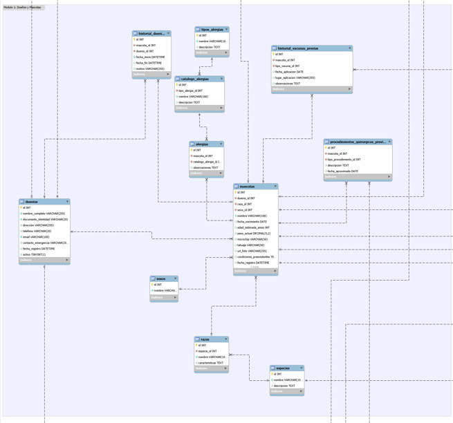
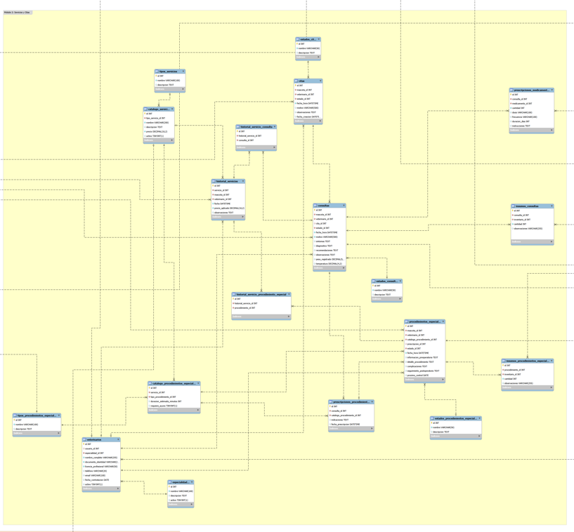
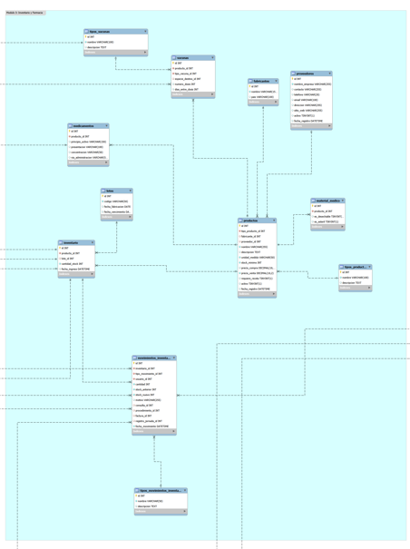
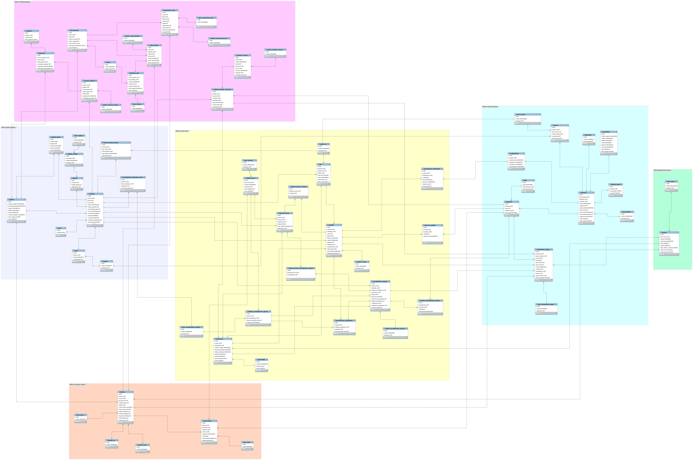

# Sistema de Gestión Integral para la Veterinaria "Happy Feet"

Aplicación de consola desarrollada en Java con base de datos MySQL que centraliza la operación de la clínica veterinaria "Happy Feet": el registro de pacientes y dueños, la agenda de citas, las consultas médicas, los procedimientos especiales y el control de inventario y farmacia.

El sistema sustituye la gestión basada en fichas de papel, agendas manuales y hojas de cálculo, y resuelve los problemas operativos de la clínica:

| Problema | Solución implementada |
|---|---|
| Historiales clínicos incompletos | Ficha centralizada por mascota con alergias, condiciones preexistentes, vacunas previas, cirugías previas, consultas, procedimientos e historial de dueños |
| Fugas de inventario | Control de stock por lote, descuento automático al usar insumos o prescribir medicamentos y registro de cada movimiento con su origen y usuario |
| Agendamiento caótico | Validación de horarios por veterinario: no se permiten citas con menos de 30 minutos de separación |
| Uso de productos vencidos | Los lotes vencidos se excluyen automáticamente de cualquier descuento y se pueden retirar del inventario |

---

## Tabla de contenido

1. [Estado del proyecto](#estado-del-proyecto)
2. [Tecnologías](#tecnologías)
3. [Arquitectura](#arquitectura)
4. [Estructura del proyecto](#estructura-del-proyecto)
5. [Módulos y funcionalidades](#módulos-y-funcionalidades)
6. [Reglas de negocio](#reglas-de-negocio)
7. [Patrones de diseño](#patrones-de-diseño)
8. [Principios SOLID](#principios-solid)
9. [Programación funcional](#programación-funcional)
10. [Manejo de errores y logs](#manejo-de-errores-y-logs)
11. [Base de datos](#base-de-datos)
12. [Instalación y ejecución](#instalación-y-ejecución)
13. [Flujo de trabajo con Git](#flujo-de-trabajo-con-git)
14. [Autor](#autor)

---

## Estado del proyecto

| Módulo | Descripción | Estado |
|---|---|---|
| 1. Gestión de Pacientes | Dueños, mascotas, información médica y transferencia de propiedad | Completado |
| 2. Servicios Médicos y Citas | Veterinarios, agenda de citas, consultas y procedimientos especiales | Completado |
| 3. Inventario y Farmacia | Productos, proveedores, lotes, alertas y descuento automático de stock | Completado |
| 4. Facturación y Reportes | Facturas en texto plano y reportes gerenciales | En desarrollo |
| 5. Actividades Especiales | Adopciones, jornadas de vacunación y club de mascotas frecuentes | En desarrollo |

---

## Tecnologías

| Tecnología | Versión | Uso |
|---|---|---|
| Java (JDK) | 25 | Lenguaje de programación |
| MySQL | 8.0 o superior | Base de datos relacional |
| JDBC (mysql-connector-j) | 9.7.0 | Conexión entre Java y MySQL |
| Apache Maven | 3.x | Gestión de dependencias y compilación |
| Apache NetBeans | 31 | Entorno de desarrollo |
| MySQL Workbench | 8.0 | Modelado y administración de la base de datos |
| Git / GitHub | — | Control de versiones con Git Flow |

---


| Capa | Paquete | Responsabilidad |
|---|---|---|
| Vista | `view` | Mostrar menús, solicitar datos y presentar resultados. Es la única capa que interactúa con la consola |
| Controlador | `controller` | Coordinar el flujo de cada opción del menú: solicita datos a la vista, invoca al servicio y decide qué mostrar |
| Servicio | `service` | Aplicar las reglas de negocio, validar la información y manejar las transacciones entre varios DAO |
| Acceso a datos | `model.dao` | Ejecutar las sentencias SQL con `PreparedStatement` y convertir los resultados en objetos |
| Entidades | `model.entities` | Representar los datos del dominio (mascotas, citas, productos, etc.) |
| Configuración | `model.config` | Leer las credenciales y administrar la conexión a la base de datos |
| Utilidades | `util` | Validación de entrada por consola, registro de errores y sesión de usuario |

Todas las capas se organizan en **subpaquetes por módulo** (`pacientes`, `servicios`, `inventario`), lo que permite ubicar rápidamente cualquier clase y mantener separadas las responsabilidades de cada módulo.

---

## Estructura del proyecto

```
GestionVeterinariaHappyFeet
├── asset/img/                     Diagramas de la base de datos por módulo
├── database/
│   ├── schema.sql                 Estructura completa de la base de datos (66 tablas)
│   ├── data.sql                   Datos iniciales: catálogos, estados y usuario administrador
│   └── diagrama.mwb               Modelo entidad-relación de MySQL Workbench
├── src/main/java/com/alangomez/gestionveterinariahappyfeet/
│   ├── Main.java                  Punto de entrada y construcción de dependencias
│   ├── controller/
│   │   ├── ControladorBase        Comportamiento común de los controladores
│   │   ├── PrincipalControlador   Menú principal
│   │   ├── pacientes/             Dueños, mascotas y menú del módulo
│   │   ├── servicios/             Veterinarios, citas, consultas y procedimientos
│   │   └── inventario/            Productos, proveedores y existencias
│   ├── model/
│   │   ├── config/                ConfiguracionBD y ConexionBD
│   │   ├── dao/                   OperacionesDAO y DAO por módulo
│   │   └── entities/              Entidades por módulo
│   ├── service/                   Servicios por módulo
│   ├── util/                      EntradaConsola, TipoTexto, RegistroErrores, SesionUsuario
│   └── view/                      VistaBase, VistaPrincipal y vistas por módulo
├── src/main/resources/
│   └── db.properties.example      Plantilla de configuración de la conexión
└── pom.xml
```

---

## Módulos y funcionalidades

### Menú principal

```
==============================
     Veterinaria Happy Feet
==============================
    1. Gestión de Pacientes
    2. Servicios Médicos y Citas
    3. Inventario y Farmacia
    0. Salir
```

### Módulo 1: Gestión de Pacientes

**Dueños**

| Funcionalidad | Descripción |
|---|---|
| Registrar dueño | Nombre completo, documento de identidad, dirección (opcional), teléfono, correo electrónico y contacto de emergencia (opcional) |
| Listar dueños | Muestra los dueños activos |
| Buscar por id | Muestra la información de un dueño |
| Eliminar dueño | Desactivación lógica; se conserva el historial |

**Mascotas**

| Funcionalidad | Descripción |
|---|---|
| Registrar mascota | Nombre, dueño, especie, raza, sexo, fecha de nacimiento o edad estimada, peso, microchip, tatuaje, URL de foto, condiciones preexistentes y alergias |
| Listar mascotas | Muestra las mascotas activas con raza, sexo y dueño |
| Ver ficha | Datos completos, alergias, vacunas previas, procedimientos quirúrgicos previos e historial de dueños |
| Transferir propiedad | Cambia el dueño y registra el traspaso en el historial con fecha y motivo |
| Agregar alergia | Asocia una alergia del catálogo con observaciones |
| Registrar vacuna previa | Vacunas aplicadas fuera de la clínica |
| Registrar procedimiento quirúrgico previo | Cirugías realizadas fuera de la clínica |
| Actualizar peso | Actualiza el peso actual |
| Eliminar mascota | Desactivación lógica |



### Módulo 2: Servicios Médicos y Citas

| Submenú | Funcionalidades |
|---|---|
| Veterinarios | Registrar (con especialidad y licencia profesional), listar, buscar y eliminar |
| Citas | Programar, consultar las citas de un día, consultar las pendientes y cambiar de estado (Programada, En proceso, Finalizada, Cancelada) |
| Consultas | Atender una cita, atender sin cita (emergencia), historial de consultas por mascota, detalle de una consulta, prescripción de procedimientos, registro de insumos utilizados y prescripción de medicamentos |
| Procedimientos especiales | Programar desde una prescripción o directamente, listar, ver detalle, cambiar de estado y registrar insumos utilizados |

Cada consulta registra la fecha y hora, el veterinario asignado, el motivo, los síntomas, el diagnóstico, las recomendaciones, el peso, la temperatura y los servicios realizados con su precio.




### Módulo 3: Inventario y Farmacia

| Submenú | Funcionalidades |
|---|---|
| Productos | Registrar medicamentos (principio activo, presentación, concentración y vía de administración), vacunas (tipo, especie destino, dosis y refuerzo) y material médico (desechable y estéril); listar con stock disponible y eliminar |
| Proveedores y fabricantes | Registrar y listar proveedores y fabricantes |
| Stock y alertas | Registrar entradas por lote, consultar el inventario por lote, ver alertas de stock bajo y de vencimiento, y retirar productos vencidos |

Las vacunas y los medicamentos se ingresan siempre con número de lote y fecha de vencimiento. El material médico puede ingresarse con o sin lote.



---

## Reglas de negocio

| Regla | Módulo | Implementación |
|---|---|---|
| El correo y el documento de un dueño son únicos | 1 | Validación en `DuenioService` y restricción `UNIQUE` en la base de datos |
| Cada mascota pertenece a un único dueño activo | 1 | Validación en `MascotaService` |
| Toda mascota tiene fecha de nacimiento o edad estimada | 1 | Validación en `MascotaBuilderImpl` y restricción `CHECK` |
| El microchip no se puede repetir | 1 | Validación antes de solicitar las alergias |
| Un dueño con mascotas activas no puede eliminarse | 1 | Validación en `DuenioService` |
| La transferencia de propiedad es atómica | 1 | Una transacción cierra el historial anterior, registra el nuevo dueño y actualiza la mascota |
| Un veterinario no puede tener citas con menos de 30 minutos de separación | 2 | Validación con Stream en `CitaService` |
| Las citas y procedimientos solo pueden programarse en fechas futuras | 2 | Validación en la vista y en el servicio |
| Los cambios de estado siguen transiciones permitidas | 2 | Tabla de transiciones en `CitaService` y `ProcedimientoService` |
| Atender una consulta es una operación atómica | 2 | Una transacción registra la consulta, los servicios realizados, finaliza la cita y actualiza el peso de la mascota |
| Al prescribir un medicamento o usar un insumo se descuenta del inventario | 2 y 3 | `InventarioService.descontar` dentro de la transacción de la consulta o el procedimiento |
| Se consumen primero los lotes que vencen antes | 3 | Orden por fecha de vencimiento (FEFO) |
| No se pueden usar productos vencidos | 3 | Los lotes vencidos se excluyen del descuento |
| No se puede descontar más de lo disponible | 3 | Validación de stock y reversión completa de la transacción |
| Todo movimiento de inventario queda registrado | 3 | Tabla `movimientos_inventario` con tipo, cantidad, stock anterior, stock nuevo, usuario y origen |
| Los datos se validan en el momento de ingresarlos | Todos | `EntradaConsola` repite la solicitud ante valores negativos, fechas inválidas o formatos incorrectos |

---

## Patrones de diseño

| Patrón | Clases | Problema que resuelve |
|---|---|---|
| **Singleton** | `ConexionBD`, `SesionUsuario` | Garantiza una única conexión compartida a la base de datos y un único registro del usuario que opera el sistema |
| **Builder** | `MascotaBuilder`, `MascotaBuilderImpl`, `ConsultaBuilder`, `ConsultaBuilderImpl` | Construye objetos con muchos atributos opcionales sin constructores extensos y valida las reglas antes de crear el objeto |
| **DAO** | `OperacionesDAO` y los DAO de cada módulo | Aísla el acceso a la base de datos del resto de la aplicación |
| **Facade** | `ConsultaService`, `ProcedimientoService`, `InventarioService` | Expone operaciones complejas que involucran varias tablas y transacciones mediante un único método |
| **Observer** | `ObservadorInventario`, `InventarioService`, `VistaExistencias` | Notifica automáticamente cuando un producto queda en o por debajo de su stock mínimo, sin acoplar el inventario con las consultas o procedimientos que lo descuentan |

---

## Principios SOLID

| Principio | Aplicación |
|---|---|
| **S** - Responsabilidad única | Cada clase tiene una sola función: las vistas muestran, los controladores coordinan, los servicios validan y los DAO acceden a la base de datos |
| **O** - Abierto/Cerrado | `TipoTexto` permite agregar nuevos formatos de validación sin modificar `EntradaConsola`; `ObservadorInventario` permite agregar nuevos receptores de alertas sin modificar `InventarioService` |
| **L** - Sustitución de Liskov | Todas las vistas heredan de `VistaBase` y todos los controladores de `ControladorBase`, y pueden usarse donde se espera la clase base |
| **I** - Segregación de interfaces | `ObservadorInventario` define un único método y las interfaces de los Builder solo contienen los métodos de construcción |
| **D** - Inversión de dependencias | Los controladores y servicios reciben sus dependencias por constructor; todas las instancias se crean en `Main` |

---

## Programación funcional

El proyecto utiliza expresiones lambda, referencias a métodos y la API Stream para el procesamiento de colecciones:

| Uso | Ejemplo en el proyecto |
|---|---|
| Filtrado | Dueños, mascotas, veterinarios y productos activos (`filter(Duenio::isActivo)`) |
| Transformación | Conversión de listas en mapas id-nombre para los menús de selección (`Collectors.toMap`) |
| Agrupación | Stock disponible por producto (`Collectors.groupingBy` con `Collectors.summingInt`) |
| Búsqueda | Validación de citas que se cruzan (`anyMatch`) y búsqueda de estados por nombre (`findFirst`) |
| Ordenamiento | Citas pendientes por fecha (`Comparator.comparing`) |
| Iteración | Impresión de tablas en las vistas (`forEach`) |

---

## Manejo de errores y logs

| Tipo de error | Tratamiento |
|---|---|
| Datos con formato incorrecto | `EntradaConsola` muestra el motivo y vuelve a solicitar el dato |
| Reglas de negocio no cumplidas | Los servicios lanzan `IllegalArgumentException` con un mensaje descriptivo que la vista muestra al usuario |
| Errores de base de datos | Los controladores capturan `SQLException`, muestran un mensaje general y registran el detalle en el archivo de log |
| Operaciones con varias tablas | Se ejecutan en una transacción; ante cualquier error se revierten todos los cambios (`rollback`) |
| Configuración incompleta | `ConfiguracionBD` indica qué clave falta o si no se encuentra el archivo de configuración |

Los errores se registran en el archivo **`errores.log`**, ubicado en la carpeta principal del proyecto, con el siguiente formato:

```
[2026-11-04 10:15:32] Menú de dueños, opción 2 -> SQLException: descripción del error
```

---

## Base de datos

La base de datos `happy_feet_veterinaria` contiene 66 tablas organizadas por módulo, con codificación `utf8mb4`.

| Archivo | Contenido |
|---|---|
| `database/schema.sql` | Creación de la base de datos, tablas, llaves foráneas, restricciones `UNIQUE` y `CHECK` e índices |
| `database/data.sql` | Catálogos (especies, razas, sexos, alergias, especialidades, servicios, tipos de producto, tipos de vacuna), estados y usuario administrador |

**Decisiones de diseño**

| Decisión | Justificación |
|---|---|
| Tercera forma normal | Los catálogos y estados se almacenan en tablas propias en lugar de valores repetidos |
| Eliminación lógica (`activo`) | Dueños, mascotas, veterinarios y productos se desactivan para conservar su historial |
| Llaves foráneas con `ON DELETE RESTRICT` | Impiden eliminar registros que tienen información relacionada |
| Supertipo y subtipos de producto | `productos` contiene los datos comunes; `vacunas`, `medicamentos` y `material_medico` contienen los datos específicos |
| Inventario por lote | Cada lote tiene su propia cantidad y fecha de vencimiento |
| Bitácora de inventario | `movimientos_inventario` registra cada entrada, salida y retiro con su origen |
| Precio aplicado en el historial | `historial_servicios` guarda el precio vigente al momento de la atención |



---

## Instalación y ejecución

### Requisitos

- JDK 25
- MySQL 8.0 o superior
- Apache Maven 3.x (o Apache NetBeans, que lo incluye)

### Pasos

**1. Clonar el repositorio**

```bash
git clone <url-del-repositorio>
cd GestionVeterinariaHappyFeet
```

**2. Crear la base de datos**

Ejecutar los scripts en este orden desde MySQL Workbench o desde la terminal:

```bash
mysql -u root -p --default-character-set=utf8mb4 < database/schema.sql
mysql -u root -p --default-character-set=utf8mb4 < database/data.sql
```

**3. Configurar la conexión**

Copiar el archivo de ejemplo y completar las credenciales:

```bash
cp src/main/resources/db.properties.example src/main/resources/db.properties
```

```properties
db.url=jdbc:mysql://localhost:3306/happy_feet_veterinaria
db.user=TU_USUARIO
db.password=TU_CONTRASENIA
```

El archivo `db.properties` está excluido del repositorio para proteger las credenciales.

**4. Compilar y ejecutar**

```bash
mvn clean compile exec:java
```

Desde NetBeans: abrir el proyecto, ejecutar **Clean and Build** y luego **Run Project**.

### Usuario inicial

| Usuario | Contraseña | Rol |
|---|---|---|
| admin | admin123 | Administrador |

---

## Flujo de trabajo con Git

El proyecto utiliza **Git Flow**:

| Rama | Propósito |
|---|---|
| `main` | Versiones estables |
| `develop` | Integración de funcionalidades |
| `feature/base-datos` | Diseño y scripts de la base de datos |
| `feature/estructura` | Estructura de capas del proyecto |
| `feature/utilidades` | Conexión y validaciones de entrada |
| `feature/Gestion-Pacientes` | Módulo 1 |
| `feature/Gestion-Servicios` | Módulo 2 |
| `feature/Gestion-Inventario` | Módulo 3 |
| `feature/Facturas-Reportes` | Módulo 4 |
| `feature/Actividades-Especiales` | Módulo 5 |

Los mensajes de commit siguen la convención **Conventional Commits** con Gitmoji (`feat`, `fix`, `refactor`, `docs`).

---

## Autor

**Alan Gómez**
[AlanGomez-Programmer](https://github.com/AlanGomez-Programmer)